<p align="center">
  <picture><source media="(max-width: 767px)" srcset="assets/readme/banner-m.png"></picture>
</p>

<p align="center">
  
  
  
</p>

A Downloads folder full of PDFs, photos and installers is easier to deal with once each kind sits in its own folder. Py File Sorter does that in one step: you pick a folder in a dialog, and every file at its top level moves into a subfolder named after its type. It is one Python file with no packages to install.

<p align="center">
  <picture><source media="(max-width: 767px)" srcset="assets/readme/glance-m.png"></picture>
</p>

## Quick start

```bash
git clone https://github.com/JustKamlesH21/Py-File-Sorter.git
cd Py-File-Sorter
python main.py
```

A folder picker opens. Choose a folder and the files move straight away; there is no preview and no confirmation step.

## How it works

<p align="center">
  <picture><source media="(max-width: 767px)" srcset="assets/readme/how-it-works-m.png"></picture>
</p>

`main.py` lists the folder, lower-cases each file's extension (so `.JPG` and `.jpg` land together), looks it up in a table of 30 extensions, creates the target folder if needed and moves the file there with `shutil.move`. Anything not in the table goes to `Others`.

| Folder | Extensions |
|---|---|
| `PDFs` | `.pdf` |
| `Documents` | `.doc` `.docx` |
| `Text_Files` | `.txt` |
| `Spreadsheets` | `.xls` `.xlsx` |
| `Presentations` | `.ppt` `.pptx` |
| `Images` | `.jpg` `.jpeg` `.png` `.gif` `.bmp` `.svg` |
| `Videos` | `.mp4` `.mov` `.avi` `.mkv` |
| `Audio` | `.mp3` `.wav` `.flac` |
| `Archives` | `.zip` `.rar` `.7z` |
| `Python_Scripts` | `.py` |
| `JavaScript_Files` | `.js` |
| `Web_Files` | `.html` `.css` |
| `Executables` | `.exe` `.dmg` |
| `Others` | everything else |

To add a type, add an entry to `file_type_mapping` in `main.py`.

## Before you run it

- **Same-named files are overwritten.** If `PDFs/report.pdf` already exists and you sort another `report.pdf`, the old one is replaced without a warning. Try it on a copy of the folder first.
- Only files at the top level move. Subfolders and their contents are left alone.
- There is no undo.

## License

No license file has been added yet, so default copyright applies.

<p align="center">
  <a href="https://github.com/JustKamlesH21"><picture><source media="(max-width: 767px)" srcset="assets/readme/footer-m.png"></picture></a>
</p>
